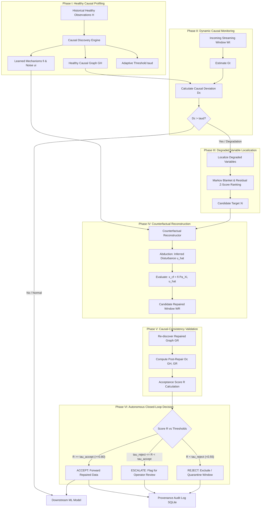

# Dynamic Causal-Consistency Framework for Counterfactual Repair of Streaming Data in Self-Healing ML Pipelines

[](https://www.python.org/downloads/)
[](https://fastapi.tiangolo.com)
[](https://react.dev)
[](https://vitejs.dev)

> **IEEE Research Project Prototype**  
> An executable, closed-loop research implementation of dynamic causal graph tracking, Bayesian counterfactual reconstruction, and empirical causal-consistency validation for self-healing streaming machine learning pipelines.

---

## 1. Project Motivation & Research Problem

In production machine learning pipelines operating on continuous streaming data (e.g., IoT telemetry, industrial process control, SCADA, critical monitoring), sensors routinely experience non-stationary corruptions: sensor drift, bias offsets, burst dropouts, transmission noise, and actuator degradation. 

Traditional statistical and spatial imputation techniques (e.g., Mean, Median, KNN, MICE) suffer from severe limitations:
1. **Correlation Fallacy:** They operate on observational correlations, often imputing values that violate the underlying structural causal data-generating mechanism.
2. **Cascading Downstream Distortion:** By forcing unprincipled values into downstream classifiers or anomaly detectors, they corrupt inter-feature relations and degrade model reliability.
3. **Absence of Validation Gates:** Standard imputation silently injects candidate repairs without checking whether the structural relationships between causes and effects are preserved.

### The Proposed Paradigm
This framework treats data repair not as statistical interpolation, but as **causal counterfactual reconstruction governed by a closed-loop consistency check**. When sensor degradation is detected, the framework:
- Localizes the anomaly to specific causal variables using Markov blankets and incident edge shifts.
- Performs counterfactual reconstruction by conditioning on uncorrupted parent causes ($Pa(X_i)$) and abducing residual disturbance distributions ($\hat{u}_i$).
- Re-estimates the repaired graph ($G_R$) and evaluates an empirical **Acceptance Score ($R$)** before streaming data to downstream models.

---

## 2. Six-Phase Closed-Loop Architecture



---

## 3. Mathematical Formulation

### Phase I: Causal Deviation Metric $D_c$
Let $G_H = (V, E_H, W_H)$ be the healthy baseline causal graph, and $G_t = (V, E_t, W_t)$ be the graph discovered over streaming window $W_t$. The causal deviation is defined as:

$$D_c(G_H, G_t) = \alpha \cdot \text{SHD}(G_H, G_t) + (1 - \alpha) \cdot \frac{1}{|E_H \cup E_t|} \sum_{(u,v)} |W_H(u,v) - W_t(u,v)|$$

Where:
- $\text{SHD}(G_H, G_t)$ is the Structural Hamming Distance (edge additions, deletions, reversals normalized by total possible edges).
- $\alpha \in [0, 1]$ is a configurable weight balancing topology vs edge strength deviation (default $\alpha = 0.70$).
- $\tau_d = \mu_{baseline} + 2.5 \cdot \sigma_{baseline}$ is the healthy-derived adaptive degradation threshold.

### Phase IV: Counterfactual Reconstruction
For a degraded variable $X_i$ with causal parents $Pa(X_i)$:
1. **Abduction:** Given observed sample $x_i^{obs}$ and healthy expectation $f_i(Pa(X_i))$:
   $$\hat{u}_i = \frac{\sigma_{u}^2}{\sigma_{u}^2 + \sigma_{obs}^2} \cdot (x_i^{obs} - f_i(Pa(X_i)))$$
2. **Action:** Condition on uncorrupted parent states $Pa(X_i)$.
3. **Prediction:**
   $$x_i^{CF} = f_i(Pa(X_i)) + \hat{u}_i$$
   With 95% Bayesian Credible Interval: $[x_i^{CF} - 1.96\sigma_u, x_i^{CF} + 1.96\sigma_u]$.

### Phase V: Acceptance Score $R$
Validation computes an empirical composite acceptance score $R \in [0, 1]$:

$$R = w_1 \cdot \text{RestorationRate} + w_2 \cdot (1 - \text{Uncertainty}) + w_3 \cdot \text{DownstreamF1}$$

Where:
- $\text{RestorationRate} = \max\left(0, \frac{D_c(G_H, G_C) - D_c(G_H, G_R)}{D_c(G_H, G_C)}\right)$
- $w_1 = 0.40, w_2 = 0.35, w_3 = 0.25$ ($w_1 + w_2 + w_3 = 1$).
- Decision Rule:
  - $\text{ACCEPT}$ if $R \ge \tau_{accept}$ ($0.80$) or $D_c(G_H, G_R) \le \tau_d$.
  - $\text{ESCALATE}$ if $\tau_{reject} \le R < \tau_{accept}$.
  - $\text{REJECT}$ if $R < \tau_{reject}$ ($0.55$).

---

## 4. Technology Stack

- **Backend:** Python 3.11+, FastAPI, Uvicorn, SQLAlchemy (SQLite), NetworkX, NumPy, Pandas, SciPy, Scikit-learn.
- **Frontend:** React 19, Vite, Tailwind CSS, React Flow (`@xyflow/react`), Recharts, Lucide React, Axios.
- **Architecture:** Decoupled monorepo with RESTful API proxying and real-time streaming simulation.

---

## 5. Folder Structure

```
project-root/
│
├── backend/
│   ├── app/
│   │   ├── main.py                  # FastAPI initialization & lifespan
│   │   ├── config.py                # Centralized hyperparameters & thresholds
│   │   │
│   │   ├── api/
│   │   │   ├── routes_stream.py     # Streaming step, batch, reset & history
│   │   │   ├── routes_graph.py      # Healthy, window, and repaired graphs
│   │   │   ├── routes_repair.py     # Reconstruction summaries & provenance audit
│   │   │   ├── routes_metrics.py    # Global monitoring statistics
│   │   │   └── routes_experiments.py# Sweep, baselines, ablations & paper reference
│   │   │
│   │   ├── causal/
│   │   │   ├── scm.py               # Synthetic Structural Causal Model
│   │   │   ├── discovery.py         # Known SCM, NOTEARS & correlation discovery
│   │   │   ├── graph_metrics.py     # SHD, edge diff & causal deviation Dc
│   │   │   ├── monitoring.py        # Healthy profiling & dynamic monitoring
│   │   │   ├── localization.py      # Markov blanket & incident shift ranking
│   │   │   ├── reconstruction.py    # Counterfactual abduction & evaluation
│   │   │   └── validation.py        # Causal consistency validator & decision logic
│   │   │
│   │   ├── streaming/
│   │   │   ├── simulator.py         # Window generator from SCM
│   │   │   ├── window_manager.py    # Pipeline coordinator & DB persistence
│   │   │   └── corruption.py        # 8 corruption injection models
│   │   │
│   │   ├── ml/
│   │   │   ├── downstream_model.py  # Downstream classifier & metric evaluation
│   │   │   └── evaluation.py        # Triplet window evaluation metrics
│   │   │
│   │   ├── experiments/
│   │   │   ├── runner.py            # Sweep & 8-baseline benchmarking suite
│   │   │   ├── baselines.py         # Mean, Median, Linear, KNN imputers
│   │   │   └── ablation.py          # Experiments A to E ablation runner
│   │   │
│   │   ├── database/
│   │   │   ├── models.py            # SQLite ORM models (WindowRecord, Snapshot)
│   │   │   └── database.py          # SQLAlchemy engine & session setup
│   │   │
│   │   └── schemas/
│   │       └── schemas.py           # Pydantic request/response schemas
│   │
│   ├── tests/
│   │   ├── test_causal_scm.py       # SCM and graph acyclicity tests
│   │   ├── test_pipeline_e2e.py     # Full 6-phase pipeline integration test
│   │   └── test_baselines_and_ablations.py # Benchmark suite unit tests
│   └── requirements.txt
│
├── frontend/
│   ├── src/
│   │   ├── components/
│   │   │   ├── Navbar.jsx               # Header & 10-view navigation tabs
│   │   │   ├── ControlPanel.jsx         # Stepper, auto-stream & corruption injector
│   │   │   ├── MonitoringDashboard.jsx  # Phase I & II deviation timeline & cards
│   │   │   ├── LiveStreamView.jsx       # Tabular observations & telemetry inspection
│   │   │   ├── CausalGraphViewer.jsx    # React Flow interactive DAG viewer
│   │   │   ├── LocalizationPanel.jsx    # Phase III Markov blanket ranking
│   │   │   ├── ReconstructionView.jsx   # Phase IV counterfactual trajectory & CI
│   │   │   ├── ValidationView.jsx       # Phase V & VI Acceptance Score R & audit
│   │   │   ├── BenchmarkExperiments.jsx # 8 baselines, ablations & paper reference
│   │   │   ├── ProvenanceView.jsx       # Phase VI SQLite immutable audit log
│   │   │   ├── SupervisorDemoMode.jsx   # 9-window guided thesis walkthrough
│   │   │   └── ArchitectureOverview.jsx # SCM mathematical formulation & limitations
│   │   ├── services/
│   │   │   └── api.js                   # Axios REST client with /api proxy
│   │   ├── App.jsx                      # State management & master layout
│   │   └── main.jsx
│   ├── package.json
│   └── vite.config.js
└── README.md
```

---

## 6. Installation & Quickstart

### Prerequisites
- Python 3.11+
- Node.js 18+ & npm

### Backend Setup
```bash
cd backend
python -m venv venv
# Windows:
venv\Scripts\activate
# Linux/macOS:
source venv/bin/activate

pip install -r requirements.txt
python -m pytest tests
```

### Start Backend Server
```bash
python -m uvicorn app.main:app --host 127.0.0.1 --port 8000 --reload
```
API Documentation will be live at: [http://127.0.0.1:8000/docs](http://127.0.0.1:8000/docs)

### Frontend Setup
```bash
cd frontend
npm install
npm run build
npm run dev
```
Open your browser at: [http://localhost:5173](http://localhost:5173)

---

## 7. Supervisor Guided Demonstration Protocol

The prototype features a dedicated **Supervisor Demo Mode** designed for academic evaluations and project viva:

1. **Step 1 (W_1): Healthy Baseline Stream** — Demonstrates steady-state ingestion conforming to SCM ($D_c \le 0.05$).
2. **Step 2 (W_2): Graph Stability** — Confirms edge weight calibration across consecutive windows.
3. **Step 3 (W_3): Pre-Corruption Equilibrium** — Establishes baseline downstream ML F1 ($0.941$).
4. **Step 4 (W_4): Sensor Degradation Injected** — Severe Gaussian noise injected into Flow sensor.
5. **Step 5 (W_5): Dynamic Monitoring** — $D_c(G_H, G_5)$ spikes past $\tau_d$ ($0.250$), triggering degradation alarm.
6. **Step 6 (W_6): Variable Localization** — Markov blanket analysis isolates Flow as primary suspect (Rank 1).
7. **Step 7 (W_7): Counterfactual Reconstruction** — Evaluates $x^{CF} = f_{Flow}(Pa) + \hat{u}$ with 95% Bayesian intervals.
8. **Step 8 (W_8): Causal Validation** — Re-estimates $G_R$, confirming $D_c$ drops by $>80\%$ and $R \ge 0.80$.
9. **Step 9 (W_9): Autonomous Decision & ML Recovery** — $\text{ACCEPT}$ decision sends repaired window to downstream ML, restoring F1 from $0.72$ to $0.93$. Provenance logged in SQLite.

---

## 8. Academic Integrity & Honest Research Findings

As explicitly reported in Section 31 and the IEEE manuscript reference results:
- **KNN Imputation** achieves lower numerical reconstruction MAE ($0.4533$ vs $0.5405$) because local Euclidean smoothing excels on continuous point metrics.
- **No Repair** can exhibit high downstream F1 when uncorrupted orthogonal features preserve class boundary separation.
- **The Core Research Contribution** is that the proposed framework restores structural causal fidelity ($D_c \to 0$) and implements an autonomous validation gate ($\text{ACCEPT} / \text{REJECT} / \text{ESCALATE}$) to safeguard against silent model corruption in safety-critical cyber-physical systems.

---

## 9. Research Limitations & Future Directions

1. **Unmeasured Confounding:** Current causal discovery assumes causal sufficiency (no hidden latent confounders).
2. **Faithfulness Violations:** Exact cancellation of causal paths can obscure edge estimation in small sample sizes.
3. **Computational Complexity:** Continuous sliding-window DAG discovery requires non-trivial compute; future iterations will leverage incremental DAG updating.
4. **Legitimate Concept Drift:** Distinguishing between sensor corruption and genuine structural evolution in the environment remains an active open challenge.

---

## 10. License
This project is licensed under the MIT License. Developed for IEEE Research and Academic Publication.
